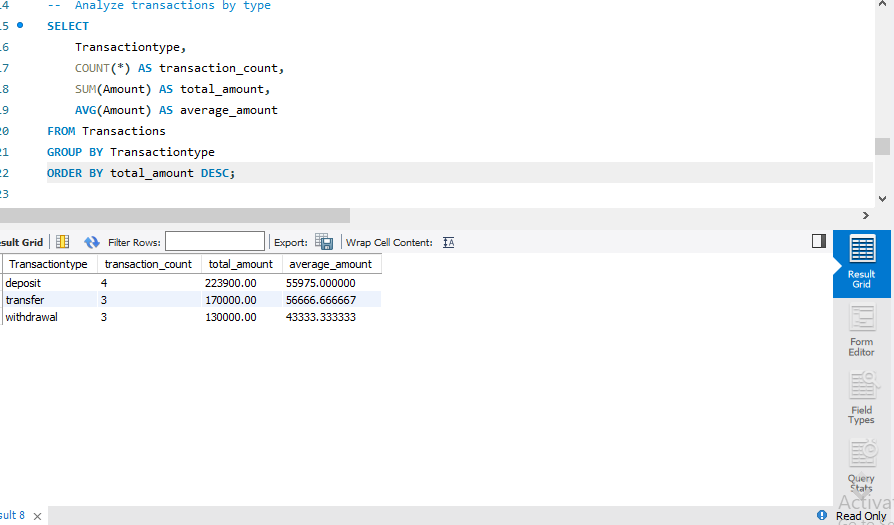
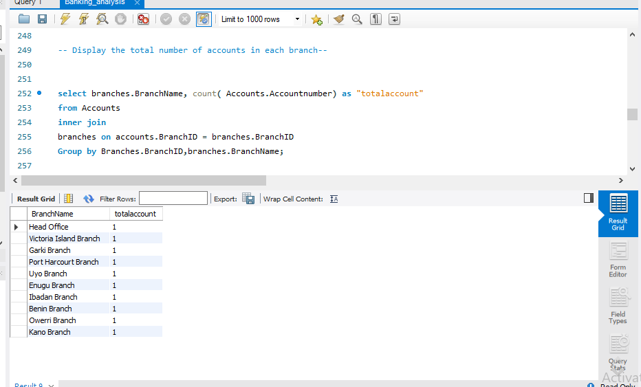

# MySQL Banking Database Project

## Project Overview
This project involves designing and managing a banking database using MySQL. It demonstrates my ability to organize relational data, work with database tables, and prepare data for querying and analysis.

## Database Tables
The database contains the following five tables:

- **Customers** – Stores customer information.
- **Accounts** – Stores account-related information.
- **Transactions** – Records banking transactions.
- **Loans** – Stores loan-related information.
- **Branches** – Contains bank branch information.

## Tools Used
- MySQL
- MySQL Workbench
- SQL

## Skills Demonstrated
- Relational database management
- Database organization and table relationships
- SQL querying
- Data retrieval and analysis
- Database export and documentation

## Project Files
The repository contains SQL files exported from MySQL Workbench for the database tables and their structure.

## How to Use
1. Install MySQL Server and MySQL Workbench.
2. Download or clone this repository.
3. Import the SQL files into MySQL Workbench.
4. Execute SQL queries to explore and analyze the data.

## Data Privacy
This project should use fictional or anonymized sample data for demonstration and learning purposes. No confidential customer information should be published.

## SQL Analysis Results

## SQL Analysis Results

### 1. Transaction Analysis

### 2. Branch Analysis

## Project Conclusion

This banking database project demonstrates the use of MySQL to store, manage, and analyze banking data. The database contains five main tables: Customers, Accounts, Transactions, Loans, and Branches.

SQL queries were used to retrieve customer information, analyze account balances, summarize transactions by type, examine loan amounts and interest rates, and evaluate account distribution across branches.

The analysis of the sample data revealed the following:

- **Customer accounts:** The database contains 10 customer records and 10 accounts.
- **Account balances:** The total balance across all accounts is ₦5,886,124, with an average balance of ₦588,612.40.
- **Transactions:** The database contains 10 recorded transactions, which can be analyzed by transaction type and amount.
- **Loans:** The total recorded loan amount is ₦540,000.
- **Branches:** The database contains 10 branches, allowing account distribution to be examined across different locations.

Through this project, I demonstrated practical skills in SQL querying, filtering, sorting, aggregate functions, joins, grouping, and relational database management.

The project provides a foundation for further banking data analysis, including interactive dashboards, customer account analysis, transaction monitoring, and loan portfolio reporting.

*Note: These findings are based on the sample data used in this project and do not represent actual banking operations.*

## Business Questions and Insights

This project uses SQL to answer practical questions about banking operations using sample data.

### Business Questions

1. **Who are the customers with the highest account balances?**  
   Identify customers with the largest balances to understand how funds are distributed among account holders.

2. **Which transaction type has the highest total transaction amount?**  
   Compare deposits, withdrawals, and transfers by transaction count and total amount.

3. **How much money is held across all customer accounts?**  
   Calculate the total and average account balances.

4. **Which branches hold the highest total account balances?**  
   Compare account balances across branches to understand the distribution of funds by location.

5. **How are loans distributed across interest rates?**  
   Group loans by interest rate and compare the number and total value of loans at each rate.

6. **Which customers have no recorded transactions?**  
   Identify accounts that may require further review or customer engagement.

### Key Insights from the Sample Data

- **Total account balance:** ₦5,886,124.
- **Average account balance:** ₦588,612.40.
- **Total recorded loan amount:** ₦540,000.
- **Transaction activity:** 10 transactions are recorded in the sample dataset.
- **Branch distribution:** The database contains 10 branches, allowing comparisons of account balances by location.

### Business Value

These analyses can help a banking team understand account balances, monitor transaction activity, review loan portfolios, and compare branch-level performance. In a real banking environment, these findings would need to be validated against complete and reconciled records before making business decisions.

*All records in this project are sample data and should not be interpreted as actual customer or banking information.*

## Banking System Dashboard

### Project Overview
This project includes an interactive Banking System Dashboard developed using Power BI and MySQL. It provides insights into customer accounts, transactions, loans, and branch performance.

### Tools Used
- MySQL – Database management and SQL queries.
- Power BI – Data visualization and dashboard development.

### Dashboard Features
- Total Account Balance
- Total Customers
- Total Transactions
- Total Loans
- Transaction Analysis by Type
- Loan Analysis by Interest Rate
- Branch Performance Analysis
- Interactive slicers for Account Type, Branch Name, and Transaction Type

### Dashboard Screenshots

## Banking System Dashboard

### Dashboard Screenshots

### Download Project Files

- [Download Banking Dashboard (PBIX)](https://github.com/bestie-crypto/mysql_bank_database/blob/main/BANKING%20DASHBOARD.pbix)

- [Download Banking Dashboard Template (PBIT)](https://github.com/bestie-crypto/mysql_bank_database/blob/main/BANKING%20SYSTEM%20DASHBOARD.pbit)

## Author
 Emmanuel Best Maobughichi
 Data analyst.
 
 

